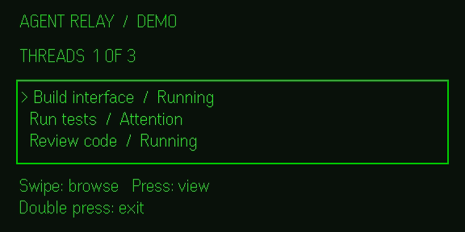

# Agent Relay

**T3 Code in your pocket. The update that matters in your field of view.**

Agent Relay is an independent Even Hub prototype for checking on coding agents without opening a laptop or taking out a phone. T3 Code still runs the agents on your workstation. Its mobile app remains the place to read the full conversation and make decisions. The wearable concept adds a quieter interface for short status updates.

## Watch the running prototype

[](https://github.com/sonozaki7/even-agent-bridge/releases/download/v0.1.3/simulator-walkthrough.mp4)

**[28-second simulator walkthrough](https://github.com/sonozaki7/even-agent-bridge/releases/download/v0.1.3/simulator-walkthrough.mp4)** · [Download the Even Hub package](https://github.com/sonozaki7/even-agent-bridge/releases/download/v0.1.3/agent-relay.ehpk)

The recording shows the actual app in Even’s official simulator. It uses sample data: browse the threads, open the one that needs attention, then confirm a simulated action. No real command is sent. The package has no network permission.

The separate **[Japan concept film](https://github.com/sonozaki7/even-agent-bridge/releases/tag/v0.1.2)** shows the future workflow: checking a question while waiting for the Shinkansen and replying with the ring. It is not a recording of the prototype or a hardware test. [Film credits and editable source](output/README.md)

## What you can try

| Mode | What it does | Where it runs |
|---|---|---|
| **Wearable demo** | Scroll between three fictional Codex and Claude Code tasks. Select “Run final checks,” then confirm to see the simulated test task resume. No command is sent. | Verified in a browser and Even Hub’s official simulator. Designed for G2/R1; physical device testing is still pending. |
| **Local T3 status** | See real thread status from T3 Code v0.1.7 with a temporary read-only credential. Questions needing a reply appear first, even if the agent is still working. The mobile app can remain paired to that same environment. | Browser on the computer running T3. Not a phone-to-glasses network connection. |

This project does not fork or modify T3 Code's [open-source mobile app](https://github.com/pingdotgg/t3code/tree/322f6544dfad0a3c8a0c8cbecf2c7f7874b14268/apps/mobile). There is no automatic approval, prompt execution, voice control, background delivery, or public service. The film illustrates what a fuller integration could feel like.

## Start the demo

Requires Node.js 22.13+.

```sh
npm --prefix app ci
npm --prefix app run dev
```

Open the local URL Vite prints. Use the preview buttons, or move between the buttons with Tab and activate them with Enter. The equivalent SDK inputs are scroll and tap; a double tap returns to the previous view. Watch for the separate confirmation before the simulated action runs.

To build the Even Hub package:

```sh
npm --prefix app run pack
```

This produces `app/agent-relay.ehpk`. The packager reports Even app 2.2.10 or newer. For first use on physical G2/R1, follow the [device check steps](app/README.md#try-the-sample-on-physical-even-g2-and-r1). The sample demo is designed to use no network access after installation. A local QR preview is not the same as installing the package; Even’s [private build route](https://hub.evenrealities.com/docs/test/private-testing) is needed to test the actual package on hardware. The app is not listed in the Even Hub catalog.

For local live status, see [the read-only bridge setup](bridge/README.md). Do not expose the local service via a public tunnel. If permission expires or T3 Code goes offline, the app shows that status is unavailable instead of replacing it with fake data.

## Checks

```sh
npm --prefix app test
npm --prefix app run build
npm --prefix bridge test
npm --prefix film ci
npm --prefix film run check
```

The app’s [browser check](app/scripts/check-ui.mjs) exercises the Even SDK against a simulated native host, plus phone layout and status error/recovery. A separate test with the [official Even Hub simulator](app/README.md#even-hub-simulator) verified the 576×288 display and scroll, tap, confirmation, cancellation, and exit behavior. The local bridge was also tried against an isolated T3 Code v0.1.7 server and correctly refused access after revocation. No physical G2/R1, package installation through the Even app, or phone lock/resume was verified.

## Next milestone

Test the packaged demo on a paired G2 and R1: read the display indoors and outdoors, scroll the list, distinguish a single tap from a double tap, confirm a demo action, and recover after disconnecting. After that, build a private, authenticated phone-to-workstation connection for status. Add real ring actions only after a separate confirmation and duplicate-request design is tested; keep sensitive approvals in the T3 mobile app.

Source code is [MIT licensed](LICENSE). Agent Relay is not affiliated with or endorsed by T3 Tools, Even Realities, OpenAI, or Anthropic. Their product names are used to identify the tools in the concept.
