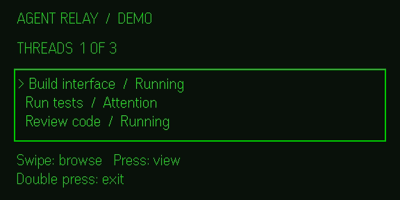

# Agent Relay — Even Hub app

Agent Relay is an independent companion prototype for T3 Code. It uses the official Even Hub SDK to draw a 576 × 288 text interface on the G2 and receive standard touch input. The same app has a browser preview with buttons, so no glasses or ring are required to try the workflow.

## Preview without an account

Requires Node.js 22.13 or newer.

```sh
npm ci
npm run dev
```

Open the local address printed by Vite (normally `http://127.0.0.1:4173`). It starts with sample threads and does not contact T3 Code. Choose **Next → View thread → Run final checks → Confirm demo** to see the full simulated interaction. After four seconds the sample status becomes **Complete**. Cancel or let the confirmation expire without starting anything.

### Even Hub simulator



The screenshot is from the simulator, not physical glasses.

With the development server still running, run:

```sh
npm run simulator -- http://127.0.0.1:4173
```

| Preview button | Even Hub control | Purpose |
| --- | --- | --- |
| Previous / Next | Swipe up / down | Select a thread |
| View thread | Press | Open the selected thread |
| Run final checks | Press | Ask for a simulated confirmation |
| Confirm demo | Press again | Advance the sample data only |
| Back / Cancel | Double press | Back out; the root page opens Even’s exit confirmation |

The ring and glasses touchpads are designed to use these same gestures through the [Even Hub SDK](https://hub.evenrealities.com/docs/build/device-apis). Physical G2/R1 input, timing, and readability still need device testing. The app does not request microphone permissions, perform voice recognition, create system notifications, or stay active outside the foreground experience.

To run the repeatable framebuffer/input check, start the simulator on a fresh demo
with `npm run simulator -- http://127.0.0.1:4173 --automation-port 9898` and run
`node scripts/check-simulator.mjs` in another terminal. The check exercises the
simulator, not physical hardware.

### Real, read-only thread status on the local computer

Build the app and follow [the local T3 relay setup](../bridge/README.md). Open the relay URL with `?source=t3`. In that view the app retrieves thread summaries from the same local server. It has no write controls and never receives the T3 Code credential. If the relay fails, the app shows **Relay offline** instead of substituting fake live status.

The installable Even Hub package has no network permission and defaults to sample data. The local read-only preview is not a remote phone service. A private phone-to-relay setup and its permissions would need separate validation; do not expose this local relay to the internet.

## Checks and packaging

```sh
npm test
npm run build
npx playwright install chromium   # if using Playwright’s bundled browser
npm run test:ui
npm run pack
```

The UI check uses headless Google Chrome if installed on macOS, or Playwright Chromium. It checks 320, 375, 390, 768, 1024, and 1440 CSS-pixel widths, including the demo action, disconnected/empty relay, long labels, and the real SDK against a mocked native host. `npm run pack` creates `agent-relay.ehpk` with the pinned SDK. Packaging is not Even Hub publication or device verification. See [official device testing](https://hub.evenrealities.com/docs/test) and [packaging](https://hub.evenrealities.com/docs/ship/packaging).
